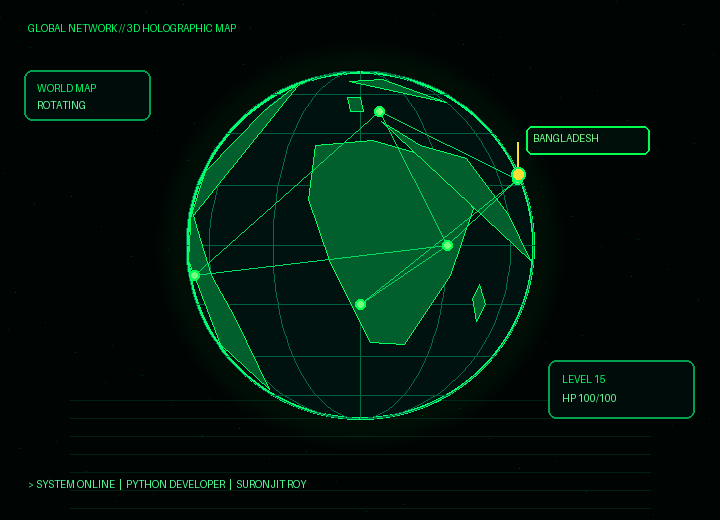

 

---

🟢 "01 // PLAYER PROFILE"

class SuronjitRoy:
    name = "Suronjit Roy"
    role = "Python Developer / Gamer"
    level = 15
    hp = "100/100 💚"
    location = "Bangladesh 🇧🇩"
    main_quest = "Building Awesome Python Apps"

    def start_quest(self):
        return "MISSION STARTED! 🚀"

player = SuronjitRoy()
print(player.start_quest())

---

🌍 "02 // 3D HOLOGRAPHIC WORLD MAP"

🟢 GLOBAL DEVELOPER NETWORK

"BANGLADESH 🇧🇩 • CODE • CONNECT • CONQUER"

---

⚡ "03 // TECH ARSENAL"

  

---

📊 "04 // GITHUB SYSTEM STATS"

  

---

🟩 "05 // CONTRIBUTION ACTIVITY"

---

🏆 "06 // ACHIEVEMENTS UNLOCKED"

---

🎯 "07 // CURRENT QUESTS"

- [x] 🐍 Start Python Development
- [x] 💻 Explore Git & GitHub
- [ ] ⚙️ Build Automation Scripts
- [ ] 🚀 Create Awesome Applications
- [ ] 🌐 Contribute to Open Source
- [ ] 🏆 Level Up Programming Skills

---

🌐 "08 // CONNECT WITH ME"

  

---

💚 CODE • CREATE • CONQUER

"SYSTEM STATUS: ONLINE"

